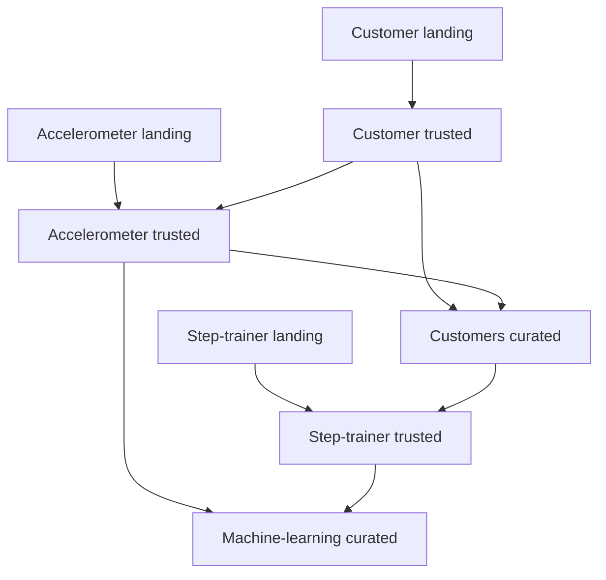

# Architecture and design choices

## Data dependencies

This describes dependencies in the exports, not a deployed orchestrator. See the [walkthrough](WALKTHROUGH.md) for SQL and execution order.

| Component | Responsibility |
|---|---|
| S3 | Holds source JSON and generated Parquet objects |
| Glue Data Catalog | Supplies schemas and locations to Glue and Athena |
| Glue Studio | Defines visual source/SQL/target nodes and exports Python |
| Spark within Glue | Executes SQL transformations |
| Athena | Queries cataloged data for samples, counts, and consent checks |

The catalog stores metadata, not another copy of the rows. Landing DDLs use a JSON SerDe. Sinks use `glueparquet`, Snappy compression, empty partition-key lists, and catalog updates at the original lab locations.

## Layers and grain

| Output | What a selected row represents |
|---|---|
| Customer landing/trusted | A registration record; trusted requires non-null consent |
| Accelerometer landing/trusted | A phone observation; trusted requires an eligible email match |
| Customers curated | A distinct selected customer record with trusted movement data |
| Step-trainer landing/trusted | A device observation; trusted requires a curated serial match and distinct selected fields |
| Machine-learning curated | One matching device/phone timestamp pair |

These descriptions explain the SQL selections, not enforced primary keys. Use the actual table names in [Validation](VALIDATION.md).

## Choices and tradeoffs

Visual jobs make transformations inspectable and exportable. SQL expresses eligibility and joins directly. Parquet stores output by column, while named catalog tables support both processing and inspection. Landing remains separate from derived layers for comparison.

The implementation meets a bounded course use case. It has no identity-aware final join, event-time consent model, anonymization, explicit output partitioning, or idempotent overwrite. `UPDATE_IN_DATABASE` updates catalog metadata; it does not delete old S3 output files. Future improvements need separate validation and may change counts.

[Back to the project](../README.md)
